# TravelPlus : mini CRM de gestion de voyages (Dynamics 365)

Projet d'entraînement sur Microsoft Dynamics 365 Sales, inspiré d'un cas d'étude :
une agence de voyages qui centralise ses voyageurs, ses voyages et ses réservations,
automatise une partie du suivi et guide le traitement des demandes de voyage.

## Fonctionnalités

- **Modèle de données** : tables Voyageur, Voyage et Réservation, avec colonnes de
  recherche (relations N:1) et un choix « Statut de réservation ».
- **Formulaires personnalisés** pour chaque table.
- **Vues filtrées** : réservations confirmées, réservations en attente, voyages disponibles.
- **Workflow** : à la création d'une réservation, le nombre de réservations du voyageur
  est incrémenté de 1.
- **JavaScript côté client** : le champ « Nombre de participants » est verrouillé
  quand le statut est « Annulée » (au chargement du formulaire et au changement du statut).
- **Business Process Flow** sur la table Prospect (Lead), en 3 phases : identification
  du prospect, analyse du besoin, suivi commercial.

## Modèle de données

Un voyageur peut effectuer plusieurs réservations, et un voyage peut être réservé
plusieurs fois. La table Réservation porte les deux colonnes de recherche.

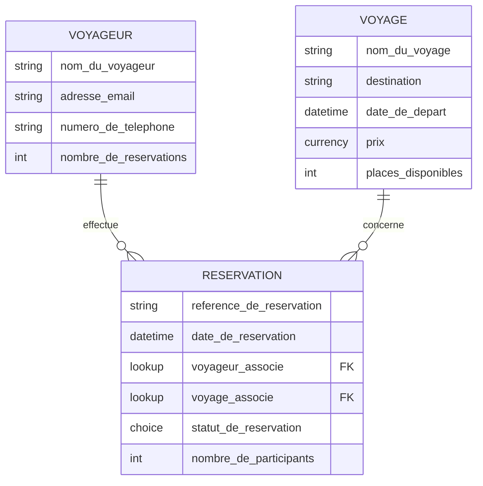

| Table | Colonnes |
|---|---|
| Voyageur | Nom du Voyageur, Adresse e-mail, Numéro de téléphone, Nombre de réservations |
| Voyage | Nom du voyage, Destination, Date de départ, Prix, Nombre de places disponibles |
| Réservation | Référence de réservation, Date de réservation, Voyageur associé (→ Voyageur), Voyage associé (→ Voyage), Statut de réservation (En attente, Confirmée, Annulée), Nombre de participants |

### Colonnes créées dans Dataverse

**Voyageur**
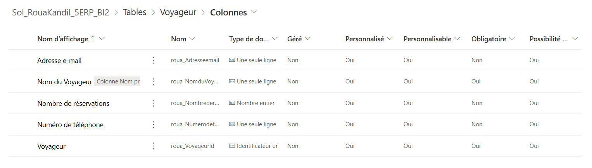

**Voyage**
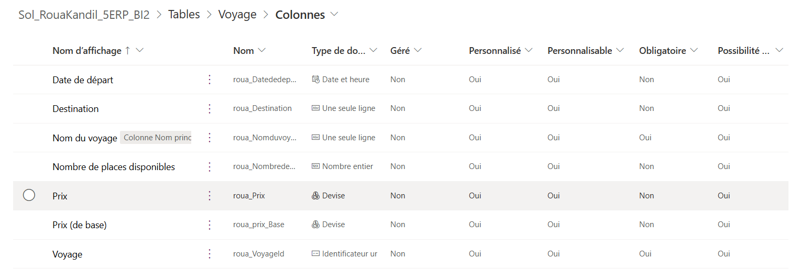

**Réservation**
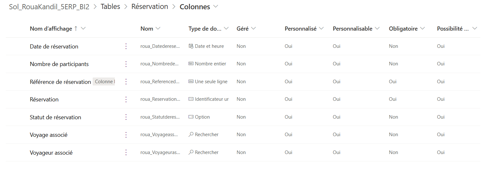

## Formulaire et vue filtrée

**Formulaire personnalisé de la table Réservation**
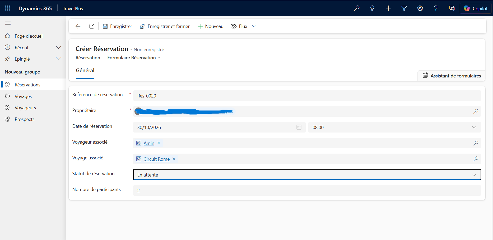

**Vue filtrée « Réservations en attente »**
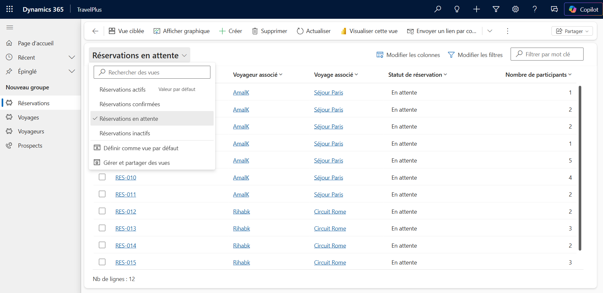

## Automatisation : workflow d'incrémentation

À la création d'une réservation, si le champ « Voyageur associé » contient des données,
le compteur « Nombre de réservations » du voyageur est incrémenté de 1.

**Définition du workflow**
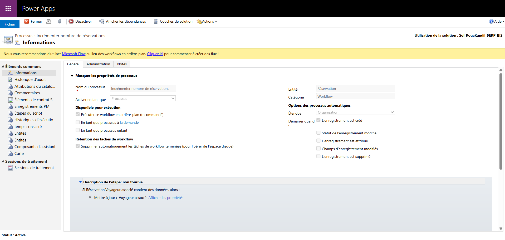

**Étape de mise à jour du voyageur (opérateur « Incrémenter de »)**
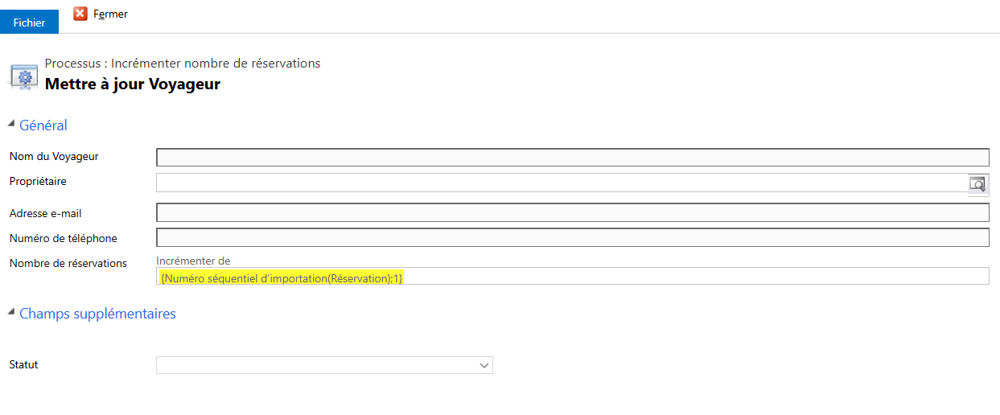

**Compteur du voyageur avant la création d'une réservation**
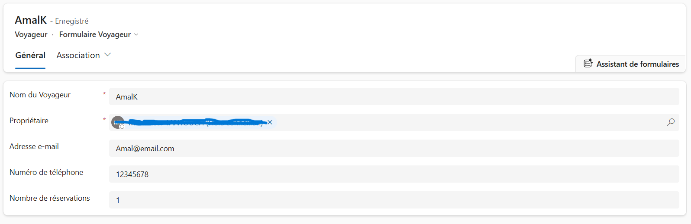

## JavaScript : verrouillage du champ « Nombre de participants »

Le script [`scripts/reservation.js`](scripts/reservation.js) est exécuté sur deux événements :
le chargement du formulaire Réservation et le changement du champ « Statut de réservation ».
Si le statut est « Annulée », le champ est désactivé ; pour tout autre statut, il est réactivé.

**Réservation annulée : le champ est verrouillé**
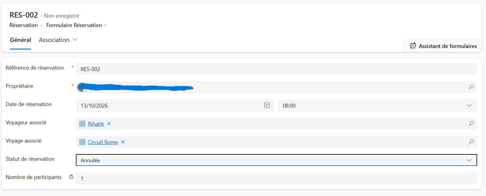

## Business Process Flow sur Prospect (Lead)

Le processus « Suivi des demandes de voyage » guide le traitement d'une demande en trois phases.
Les colonnes personnalisées nécessaires ont été créées sur la table Prospect.

**Colonnes personnalisées de la table Prospect**
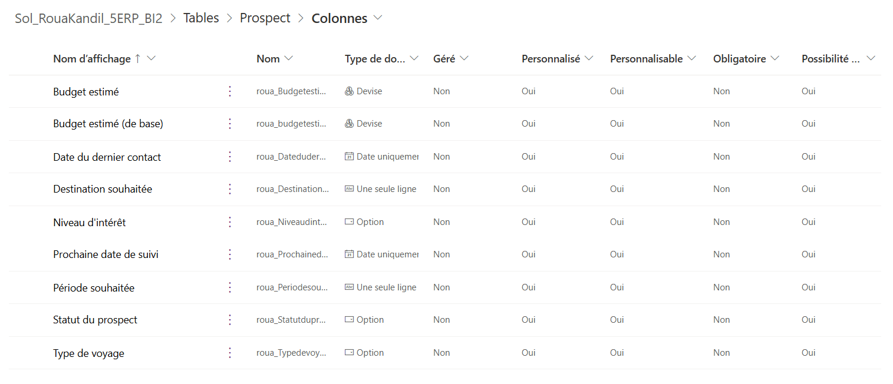

**Un prospect avec la barre du BPF**
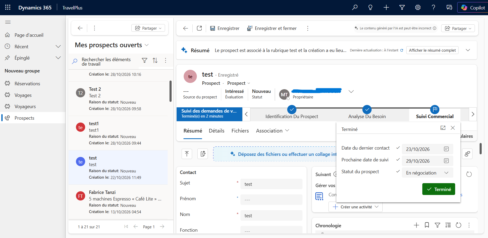

## Contenu du dépôt

| Dossier | Contenu |
|---|---|
| `solution/` | Solution Dynamics 365 exportée (non managée) |
| `scripts/` | Code JavaScript du formulaire Réservation |
| `docs/screenshots/` | Captures d'écran du projet |

## Installation

1. Dans Power Apps, ouvrez **Solutions** puis **Importer une solution**.
2. Sélectionnez `solution/TravelPlus_solution_unmanaged.zip`.
3. Publiez toutes les personnalisations.

Note : dans `scripts/reservation.js`, la valeur `114810002` correspond à l'option
« Annulée » dans mon environnement. Après un import, vérifiez la valeur du choix et
adaptez-la si besoin.

## Compétences mises en œuvre

Dataverse (tables, colonnes, relations), Power Apps model-driven, formulaires et vues,
workflows classiques, JavaScript (Client API), Business Process Flow,
gestion de solutions (export / import).

## Pistes d'amélioration

- Tableau de bord Power BI (taux de qualification, budget moyen, répartition
  par type de voyage), connecté à Dataverse.
- Décrémenter le compteur lors de l'annulation ou de la suppression d'une réservation.
- Contrôle du nombre de places disponibles au moment de la réservation.
